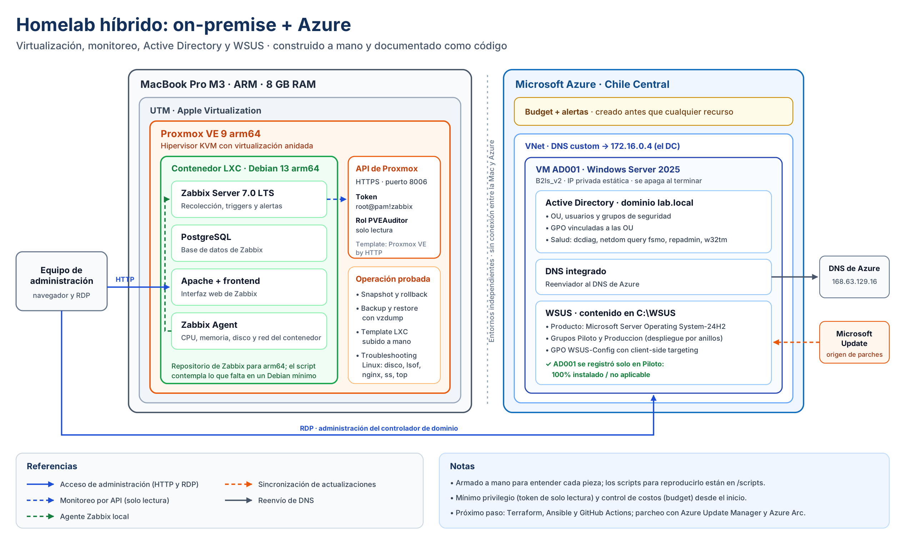

# Homelab híbrido: on-premise + Azure

Laboratorio personal de infraestructura: virtualización on-premise con Proxmox, monitoreo con Zabbix, y Active Directory con WSUS en Azure.

Lo armé primero a mano, para entender cada pieza y sus problemas reales. Este repositorio documenta lo que hice, las decisiones que tomé, los errores que resolví y los scripts para reproducirlo. El siguiente paso es convertir todo en código (ver [Roadmap](#roadmap)).

## Arquitectura



## Qué incluye

| Componente | Qué hice | Documentación |
|---|---|---|
| Proxmox VE 9 (arm64) | Instalación en UTM, repositorios, contenedor LXC, snapshots, backup y restore | [docs/01-proxmox.md](docs/01-proxmox.md) |
| Zabbix 7.0 LTS | Servidor en LXC, monitoreo del agente local y de Proxmox por API con mínimo privilegio | [docs/02-zabbix.md](docs/02-zabbix.md) |
| Active Directory | DC en Azure, DNS, OU, usuarios, grupos, GPO y chequeos de salud | [docs/03-active-directory.md](docs/03-active-directory.md) |
| WSUS | Sincronización, grupos Piloto y Producción, GPO con client-side targeting | [docs/04-wsus.md](docs/04-wsus.md) |
| Troubleshooting Linux | Ejercicios de disco lleno, archivos borrados abiertos, servicios caídos, puertos y CPU | [docs/05-troubleshooting-linux.md](docs/05-troubleshooting-linux.md) |

## Lecciones y detalles a tener en cuenta

- **WSUS y los nombres de producto:** para Windows Server 2025 el producto a sincronizar es *Microsoft Server Operating System-24H2*. Opciones de nombre parecido, como *Windows - Server, version 24H2 and later, Upgrade & Servicing Drivers*, no traen los parches de seguridad.
- **Disponibilidad de tamaños por región:** en una suscripción gratuita, algunos tamaños de VM no están habilitados en todas las regiones. Conviene validar región y tamaño antes de diseñar.
- **Repositorios por arquitectura:** en ARM, Zabbix tiene un repositorio propio (`debian-arm64`); el genérico es para amd64.
- **Contenedores Debian mínimos:** no traen `sudo`, ni el servidor PostgreSQL, ni el locale `en_US.UTF-8` que pide el frontend de Zabbix. El script de instalación ya lo contempla.

## Principios aplicados

- **Control de costos primero:** budget y alertas en Azure antes de crear cualquier recurso; la VM se apaga cuando no se usa.
- **Mínimo privilegio:** Zabbix lee Proxmox con un token de solo lectura, no con root.
- **Despliegue por anillos:** los parches pasan por Piloto antes de Producción.
- **Sin secretos en el repositorio:** las contraseñas se piden en tiempo de ejecución (ver `.gitignore`).

## Estructura

```
.
├── docs/                    Documentación por componente y capturas
└── scripts/
    ├── proxmox/             Token de API de solo lectura para monitoreo
    ├── zabbix/              Instalación de Zabbix 7.0 + PostgreSQL en Debian 13 arm64
    ├── active-directory/    Promoción del DC, estructura de OU y chequeo de salud
    └── wsus/                Instalación de WSUS y grupos de equipos
```

## Roadmap

- [ ] Infraestructura de Azure con Terraform (VNet, VM, NSG, budget)
- [ ] Contenedores de Proxmox con Terraform y configuración con Ansible
- [ ] Pipeline de GitHub Actions: `fmt`, `validate`, escaneo con Trivy, `plan` y `apply` con aprobación
- [ ] Backup con Veeam y prueba de restauración
- [ ] Estimación de costos con Infracost en cada *pull request*
- [ ] Migración del parcheo a Azure Update Manager con Azure Arc

## Autor

Leonardo Díaz · Cloud & DevOps Engineer · Buenos Aires
