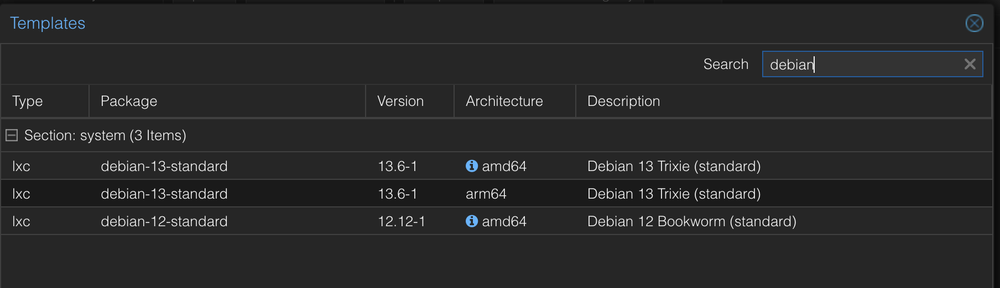

# 01 · Proxmox VE 9 en una Mac con Apple Silicon

## Contexto

Mi única máquina es una MacBook Pro M3 (ARM) con 8 GB de RAM. Proxmox oficial es x86, así que usé el port arm64 dentro de UTM con el backend de Apple Virtualization, que soporta virtualización anidada.

## Pasos

1. VM en UTM con Apple Virtualization, 3 GB de RAM.
2. Instalación de Proxmox VE 9 arm64.
3. Repositorio *enterprise* deshabilitado y *no-subscription* habilitado; `apt update && apt full-upgrade`.
4. Verificación de KVM: `ls -l /dev/kvm` existe, así que la virtualización anidada funciona.
5. Template LXC Debian 13 arm64. La descarga desde la interfaz se trababa, así que lo bajé desde la Mac y lo subí al storage `local`.
6. Contenedor LXC creado desde ese template.



## Diagnóstico de red en LXC

Si un contenedor arranca pero no tiene conectividad:

1. Dentro del contenedor, `ip a` muestra si la interfaz está `DOWN` o sin dirección.
2. En *Network* del contenedor, verificar el bridge (`vmbr0`) y la configuración IPv4.
3. Una interfaz en *Static* sin dirección queda caída: se resuelve asignando una IP o pasando a DHCP.

## Operación probada

- **Snapshot y rollback:** snapshot antes de un cambio, rompo algo y vuelvo atrás.
- **Backup y restore:** backup con `vzdump` al storage local y restauración en un contenedor nuevo.

```bash
pct snapshot <ctid> antes-de-cambio
pct rollback <ctid> antes-de-cambio
vzdump <ctid> --storage local --mode snapshot
```

## Por qué importa

Proxmox usa KVM, igual que Red Hat Virtualization, con la que trabajé como consultor. Los conceptos se trasladan: almacenamiento, redes con bridges, snapshots y backups.
