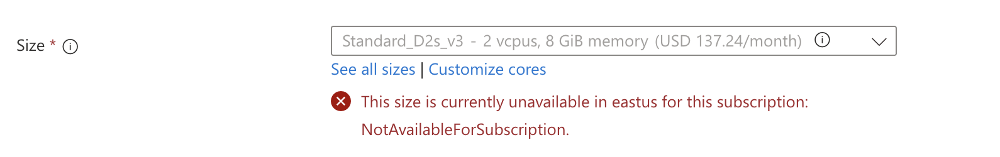

# 03 · Active Directory en Azure

## Por qué en Azure

Windows Server no corre bien sobre ARM en mi equipo, así que la parte Windows la armé en una cuenta gratuita de Azure.

## Control de costos antes de empezar

1. **Budget con alertas** en la suscripción, antes de crear cualquier recurso.
2. VM chica: **B2ls_v2** (2 vCPU, 4 GB).
3. La apago desde el portal al terminar cada sesión. El *auto-shutdown* no estaba disponible en la región.

## Región

En East US el tamaño elegido no estaba disponible para la suscripción gratuita, así que usé **Chile Central**.



## Red y DNS

| Elemento | Configuración |
|---|---|
| VM | AD001 · Windows Server 2025 Datacenter Azure Edition |
| IP privada | Estática (172.16.0.4) |
| DNS de la VNet | Custom, apuntando al DC |
| Forwarder del DC | 168.63.129.16 (DNS de Azure) |

**Por qué:** las máquinas del dominio tienen que resolver `lab.local` contra el DC, y el DC reenvía todo lo demás al DNS de Azure.

## Dominio

- Promoción a controlador de dominio del bosque nuevo `lab.local`, con DNS integrado.
- OU, usuarios y grupos de seguridad.
- GPO vinculadas a las OU.

Lo hice desde Server Manager. El equivalente en PowerShell está en [`scripts/active-directory`](../scripts/active-directory).

## Chequeos de salud

```powershell
dcdiag                     # diagnóstico general del DC
dcdiag /test:dns           # salud del DNS
netdom query fsmo          # quién tiene los 5 roles FSMO
w32tm /query /status       # sincronización de hora (Kerberos depende de ella)
repadmin /replsummary      # estado de la replicación
```

**Prueba de falla:** detuve el servicio *DNS Server*, `dcdiag /test:dns` falló, lo arranqué y volvió a pasar.

Script: [`scripts/active-directory/03-health-check.ps1`](../scripts/active-directory/03-health-check.ps1)
