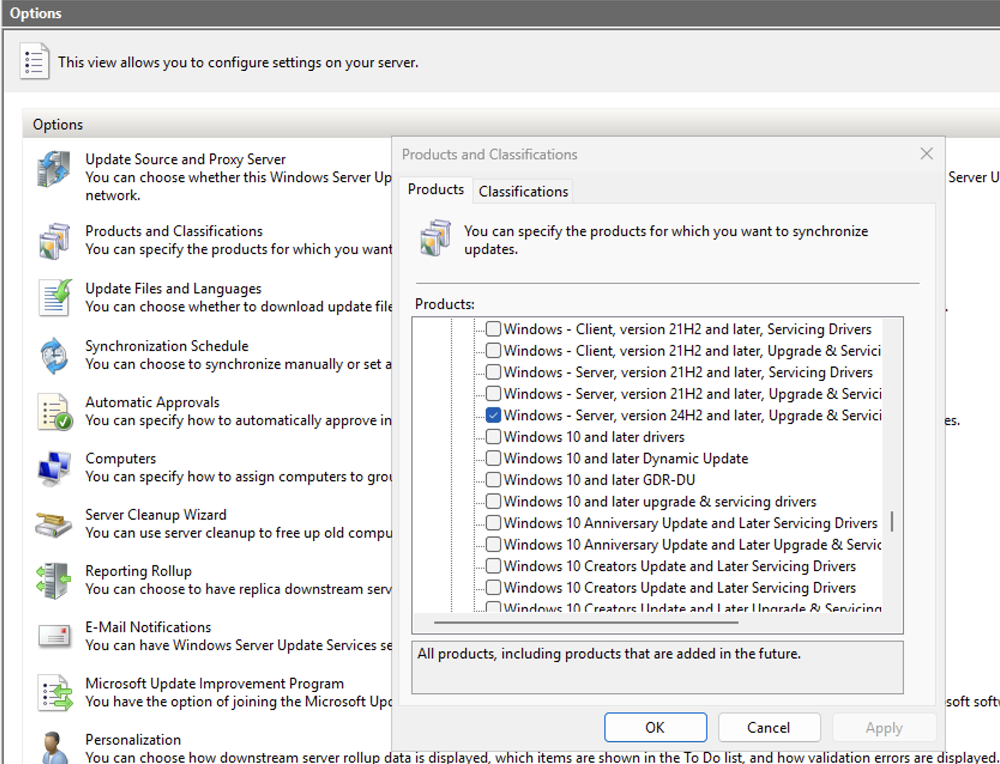
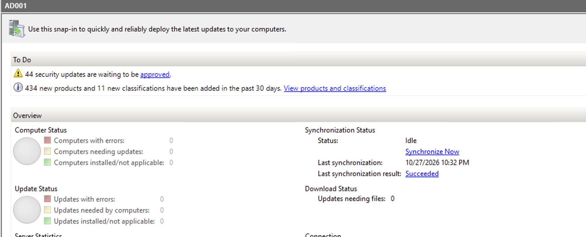
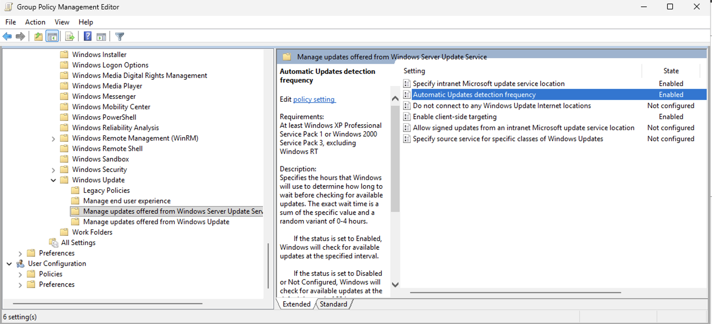
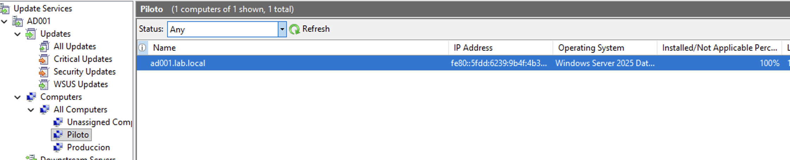

# 04 · WSUS con despliegue por anillos

## Instalación

- Rol WSUS en AD001 con base de datos interna (WID).
- Contenido en `C:\WSUS`.
- Sincronización con Microsoft Update.

## Lección: elegir bien el producto

La primera sincronización no trajo nada útil: había elegido *Windows - Server, version 24H2 and later, Upgrade & Servicing Drivers*.

El producto correcto para Windows Server 2025 era **Microsoft Server Operating System-24H2**. Con ese, la sincronización trajo 44 actualizaciones de seguridad.

## Anillos

Dos grupos en WSUS: **Piloto** y **Produccion**. Los parches se aprueban primero para Piloto y, después de validarlos, para Producción.

## GPO `WSUS-Config`

Ruta: *Computer Configuration › Administrative Templates › Windows Components › Windows Update*

| Configuración | Valor |
|---|---|
| Specify intranet Microsoft update service location | `http://AD001:8530` |
| Enable client-side targeting | `Piloto` |
| Configure Automatic Updates (en *Manage end user experience*) | Opción 3: descarga automática, aviso para instalar |
| Automatic Updates detection frequency | 22 horas |

**Por qué client-side targeting:** cada servidor queda en su anillo según la GPO de su OU, sin moverlo a mano en la consola.

## Resultado

AD001 se registró solo en el grupo Piloto con **100% Installed/Not Applicable**.

## Hacia dónde va esto

Microsoft anunció en septiembre de 2024 que WSUS queda deprecado. El camino natural es **Azure Update Manager** con **Azure Arc** para los servidores on-premise, manteniendo la misma lógica de anillos.
